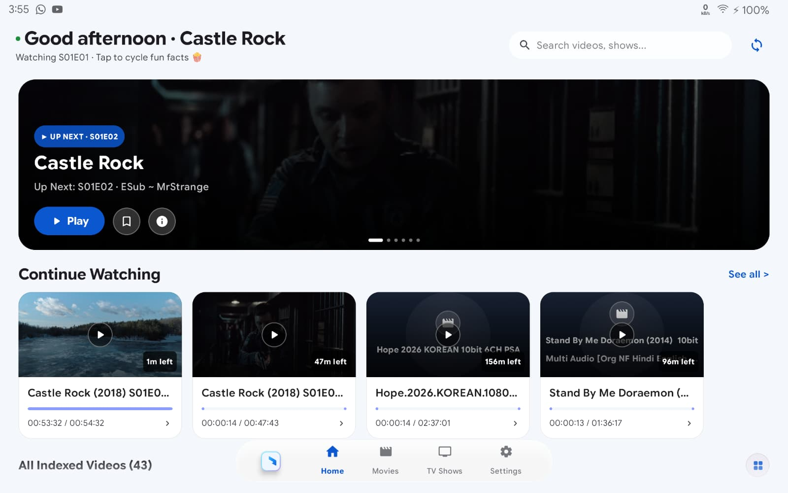
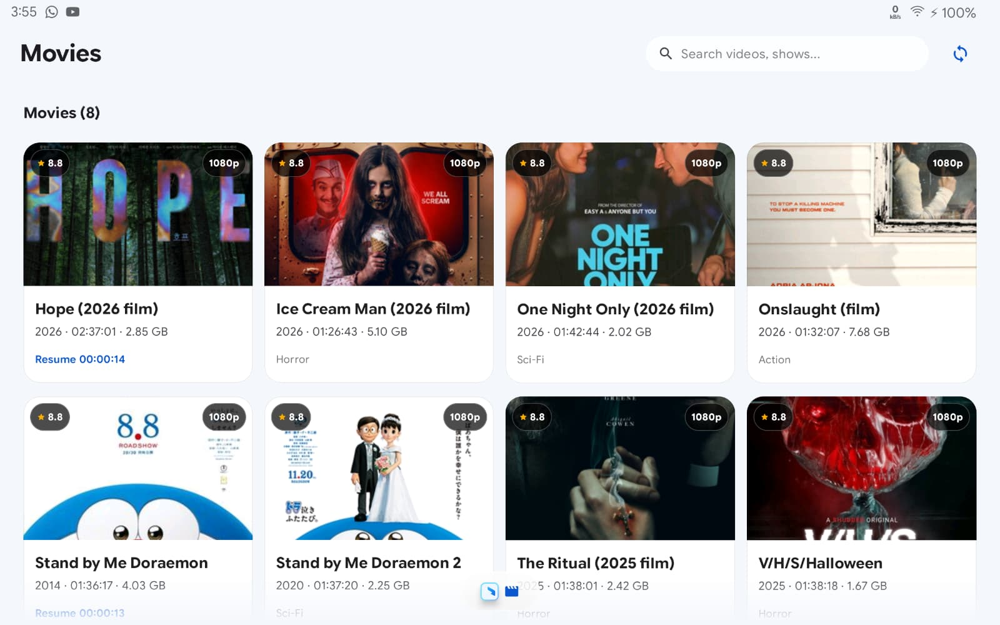
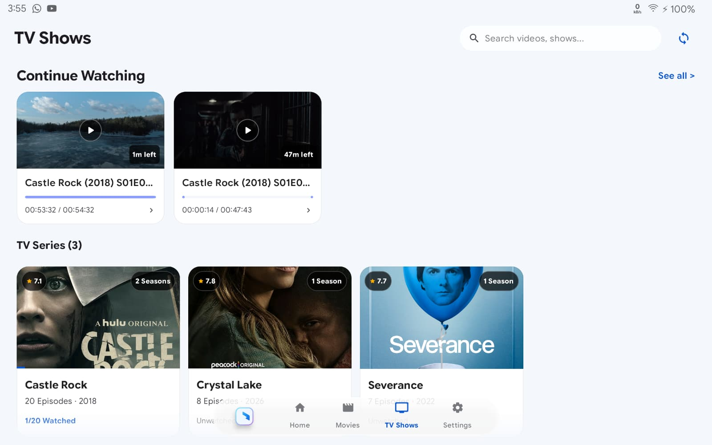
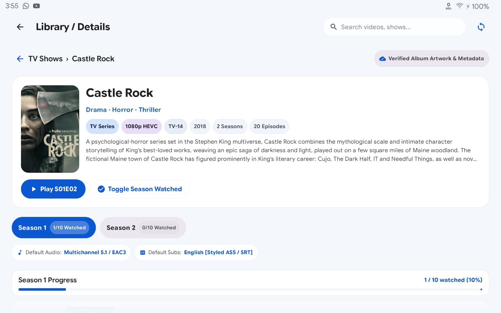
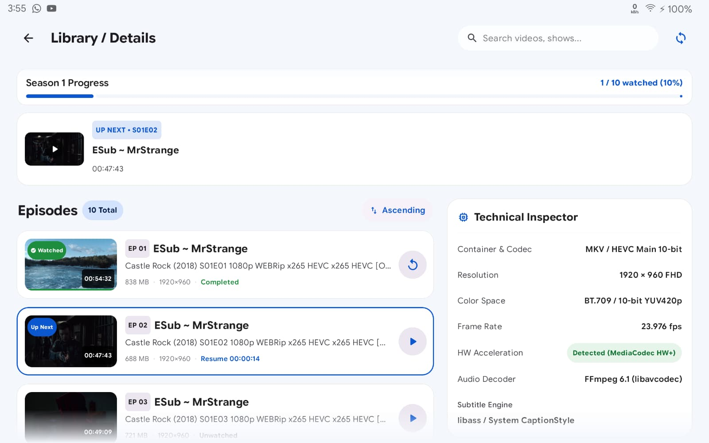
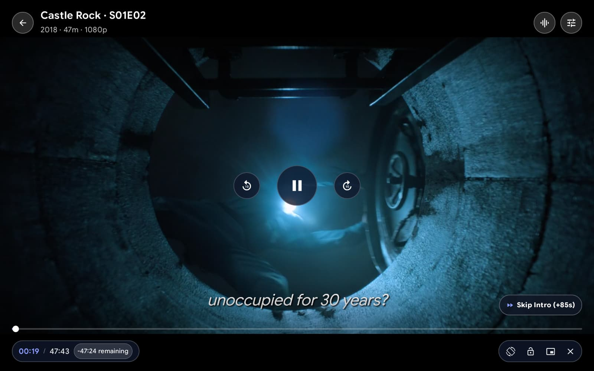
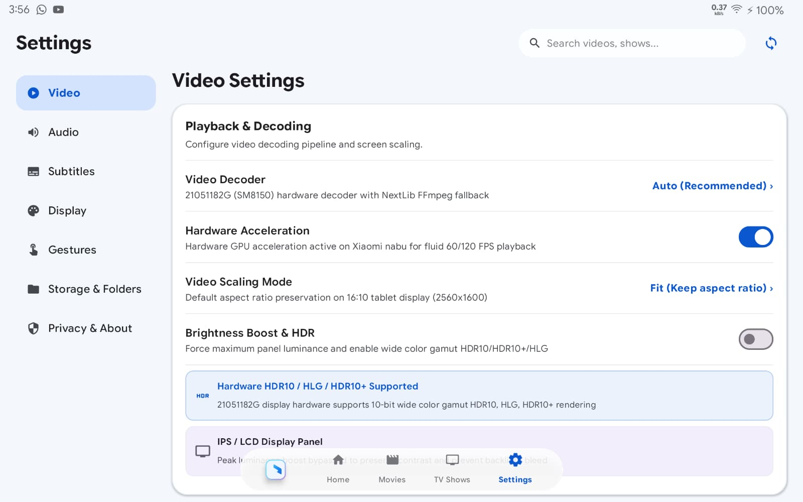
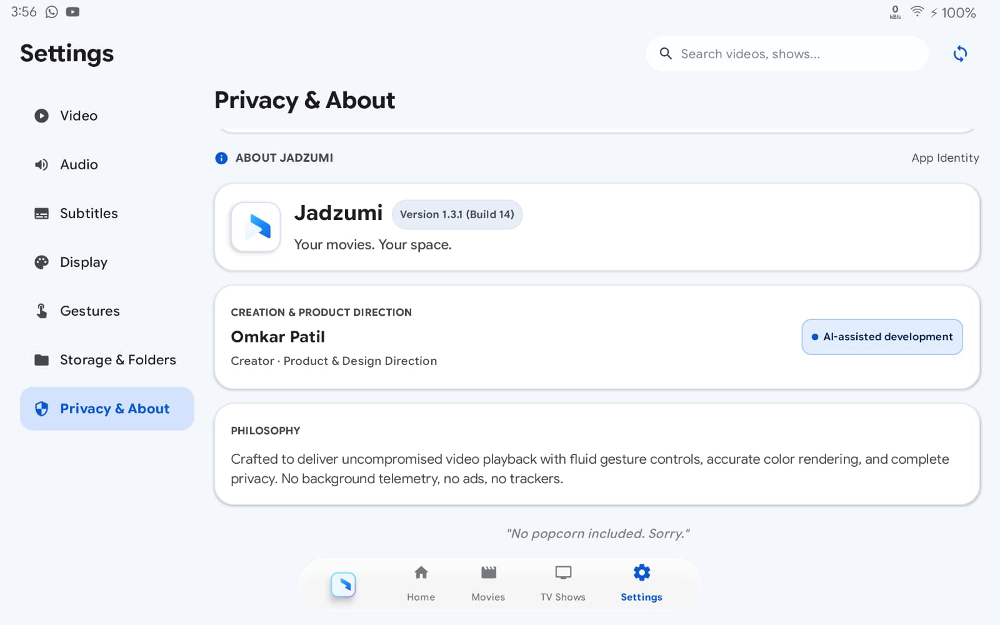

<h1 align="center">Jadzumi Video Player</h1>

<strong>Your movies. Your space.</strong> A free, offline-first Android video player for phones, foldables, and tablets.

  
  
  
  

  <a href="https://github.com/omkaarpatil787-dev/Jadzumi-Video-Player/releases/latest"><strong>Download APK</strong></a> ·
  <a href="RESUME.md">Project summary</a> ·
  <a href="docs/DEVELOPMENT.md">Developer guide</a>

Watch your local movies and TV shows with gesture controls, subtitles, and a library
that remembers where you left off. Built with Jetpack Compose and AndroidX Media3,
with NextLib FFmpeg software decoders alongside Android's platform decoders.

## 📸 Screenshots

  

Home · Continue watching · Your local video library

<strong>Explore the library, player, and settings</strong>

<table>
  <tr>
    <td width="50%" align="center"><strong>Movies</strong> </td>
    <td width="50%" align="center"><strong>TV shows</strong> </td>
  </tr>
  <tr>
    <td align="center"><strong>Series details</strong> </td>
    <td align="center"><strong>Episodes &amp; inspector</strong> </td>
  </tr>
  <tr>
    <td align="center"><strong>Playback</strong> </td>
    <td align="center"><strong>Video settings</strong> </td>
  </tr>
  <tr>
    <td colspan="2" align="center"><strong>Privacy &amp; About</strong> </td>
  </tr>
</table>

Tablet screenshots from v1.3.1. Some labels and version details differ from the current release.

<strong>What’s new · v1.7.3 🎨✨</strong>

- **Subtitle Typography Suite & 3D Edge Effects**: Added Cinema Serif, Heavy Sans, Rounded Sans, and Roboto Condensed fonts, weight/style selections (Regular, Bold, Italic, Bold Italic), 3D raised/depressed edge bevels, soft atmospheric glows, and adjustable bottom margin calibration with a live preview card.
- **Theme-Reactive Playback UI**: Video player overlay controls, HUD pills, seek buttons, and volume/brightness bars dynamically adapt to active themes: Light mode frosted milk-glass (`#F0F4FC`) with navy typography (`#183654`), Dark mode slate-navy (`#0F172A`), and AMOLED mode pure ink-black (`#000000`).
- **Decluttered Minimalist Player HUD**: Streamlined single-row bottom timeline docking progress scrubber, elapsed/remaining timecode, rotation, lock, and PiP into a clean, unified dock. Secondary tools moved to the Quick Menu drawer.
- **Pure Flat Modern Cards**: Completely eliminated hardware Skia shadow lips and corner emboss borders across all cards and settings panels (`shadowElevation = 0.dp`, `border = null`).

See [release notes](RELEASE_NOTES.md) for full details.

## ✨ Highlights

| Playback | Your library | Make it yours |
| --- | --- | --- |
| Hardware decoding with FFmpeg fallback | Continue watching and resume positions | Light, dark, and AMOLED themes |
| GPU Video Enhancer & Color Studio | Movies, series, seasons, and episodes | Portal Halo atmospheric backdrops |
| Expanded Audio Studio & Channel Modes | Local artwork and metadata sidecars | Pure flat modern cards (zero highlights) |
| Double-tap seek and hold-to-2× speed | Poster grid, list view, and batch actions | Subtitle typography suite & 3D glows |
| External subtitles and timing adjustments | Scene bookmarks, notes, and search | Theme-reactive playback controls |
| Background audio and picture-in-picture | Episode continuity and sleep timer | Refresh rate matching |

## 📦 Latest release · v1.7.3

- 🔤 **Subtitle Typography Suite**: 4 new cinema fonts, full weights/styles, 3D raised/depressed edges, soft glows, and live preview.
- 🌓 **Theme-Reactive Playback HUD**: Light frosted milk-glass, Dark slate-navy, and AMOLED ink-black overlay HUDs.
- 🎬 **Decluttered Minimalist HUD**: Single-row bottom timeline dock with quick menu drawer integration.
- 🪟 **Pure Flat Modern Cards**: Zero elevation shadow lips and zero corner emboss across all cards.

[Download v1.7.3](https://github.com/omkaarpatil787-dev/Jadzumi-Video-Player/releases/tag/v1.7.3) · [Release notes](RELEASE_NOTES.md)

**Upgrading from an older development-signed APK?** The new signing key requires
reinstallation. Uninstalling can erase app settings and playback history.

## 🔒 Privacy

No ads, analytics, or background telemetry. Your playback history stays on your device.

Online lookups are **off by default**. Enable them in **Settings → Privacy & About**
to request movie/TV information from Wikipedia and TVMaze, plus artwork from their
image hosts. This sends search titles to those services. Cached information and
images remain available offline when lookups are disabled.

GitHub update checks are available in **Privacy & About**.
Manual checks contact GitHub when requested; automatic checks have their own
**off-by-default** switch. APK downloads and installation require your action.

## 🛠️ Development

Requires **Android 8.0+** and an **ARM64** device. The project uses Kotlin 2.2.10,
Jetpack Compose, Media3 1.11.1, and NextLib with FFmpeg 9.0.1.

See the [developer guide](docs/DEVELOPMENT.md) for building and release setup, or the
[project summary](RESUME.md) for architecture and validation details.

## 📄 License

Jadzumi is free and open source under [GPL-3.0](LICENSE). Open-source notices are
included in **About → Licenses** and [Third-party licenses](THIRD_PARTY_LICENSES.md).

Artwork redistribution terms, native Corresponding Source completeness, and
[legal review items](LEGAL_REVIEW_REQUIRED.md) remain under review; this project
does not claim legal clearance.
